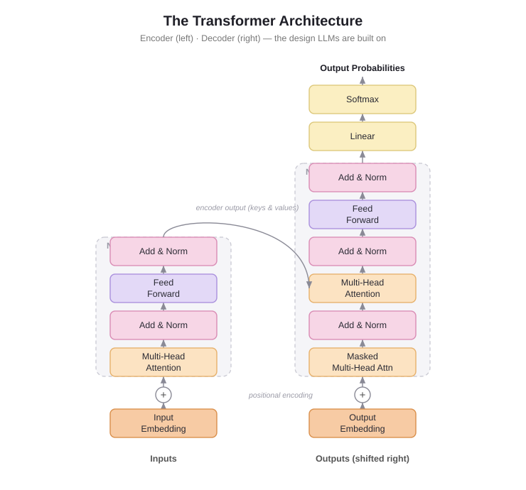

# LLM & the Transformer — The Agent's Brain


## 1. What is an LLM?

An **LLM (Large Language Model)** is a computer program trained using a huge amount of text, such as books, websites, articles, and computer code.

By studying all this text, it learns patterns in language. This allows it to understand instructions, generate answers, and solve different problems.

In an AI agent, the LLM acts as the **brain**. It is responsible for making decisions.

Remember the five agency levels we studied earlier?

- **Router** → The LLM decides which path to take.
- **Tool caller** → The LLM decides which tool to use.
- **Multi-step agent** → The LLM decides what to do next and when to stop.
- **Multi-agent** → The LLM decides when to start another agentic workflow.

**Important caveat:** The LLM itself only generates output (usually text). It cannot directly perform actions such as checking a gym membership, calling an API, or reading a file.

For example, if the LLM generates:

```json
{
    "tool": "check_membership"
}
```

It has only *suggested* which tool to use. Python must execute that tool.

Therefore:

> **AI Agent = Brain (LLM) + Body (Tools + Python code)**

The LLM decides; the surrounding program performs the action and sends the result back to the LLM.


## 2. The core job: Next-token prediction

An LLM does one main thing: predicts the **next token** based on the text it has received.

A token is a small piece of text. It can be:

- A complete word.
- Part of a word.
- A punctuation mark.
- A number or other text symbol.

For example, imagine the input:

```
The capital city of Nepal is
```

The model predicts the next token:

```
Kathmandu
```

It then predicts the next token based on the updated text, repeating this process until the answer is complete.

This is called **next-token prediction**.

The same process produces different kinds of output:

- A normal chatbot response.
- An explanation of a technical concept.
- A JSON response such as `"tool": "check_membership"`.
- A decision about which tool to use in an AI agent.

**Important:** Even when an LLM makes a decision for an agent, it is still generating tokens. The surrounding Python program interprets that output and performs the action.

### Special tokens & the EOS token

Each LLM has some **special tokens** specific to the model. The LLM uses these tokens to open and close the structured parts of its generation — for example, to mark the start or end of a sequence, message, or response. The prompts we pass in are also structured with special tokens. The most important one is the **End of Sequence token (EOS)**.

The forms of special tokens vary a lot across providers:

| Model | Provider | EOS Token | Functionality |
|---|---|---|---|
| GPT-4 | OpenAI | `<\|endoftext\|>` | End of message text |
| Llama 3 | Meta (FAIR) | `<\|eot_id\|>` | End of sequence |
| Deepseek-R1 | DeepSeek | `<\|end_of_sentence\|>` | End of message text |
| SmolLM2 | Hugging Face | `<\|im_end\|>` | End of instruction or message |
| Gemma | Google | `<end_of_turn>` | End of conversation turn |

You don't need to memorize these — just appreciate their diversity and the role they play. You can find a model's special tokens in its `tokenizer_config.json` on the Hugging Face Hub.

### Autoregressive decoding

LLMs are **autoregressive**: the output from one pass becomes the input for the next. The model generates a token, appends it, and runs again — this loop continues until it predicts the **EOS token**, at which point it stops.

What happens in a single decoding loop (brief, non-technical):

1. The input text is **tokenized**.
2. The model computes a representation of the sequence that captures the **meaning and position** of each token.
3. It outputs **scores** ranking how likely each token in its vocabulary is to be next.
4. A **decoding strategy** picks the next token from those scores.

**Decoding strategies:**

- **Greedy (simplest)** — always take the token with the highest score.
- **Beam search** — explores multiple candidate sequences and keeps the one with the best *total* score, even if some individual tokens scored lower.

> The HF course shows this as an animation and lets you try it interactively with SmolLM2 in a Space (it decodes until its EOS token, `<|im_end|>`).

---

## 3. Built on the Transformer

Almost all modern LLMs are built using an architecture called the **Transformer**.

The Transformer architecture was introduced in 2017 in a research paper called *Attention Is All You Need*.

It later became the foundation for many popular language models, including BERT, GPT, Llama, and Qwen.

### Attention — The key idea

Attention is the most important mechanism in the Transformer.

It helps the model understand which other words or tokens are important when processing a particular token.

For example:

- "I deposited money in the **bank**."
- "I sat beside the **bank** of the river."

The word *bank* appears in both sentences, but its meaning is different.

Attention helps the model use the surrounding words to understand which meaning is relevant.

Think of attention as the model asking:

> "Which other words in this sentence should I pay attention to understand this word?"

**Context length.** The core principle (predict the next token) has stayed the same since GPT-2; the big advances have been in *scaling* and in making attention work over longer sequences. The **context length** is the maximum number of tokens an LLM can process at once — effectively its maximum attention span. (This is the `num_ctx=8192` you set in `test.py`.)

### Walking through the Transformer diagram (bottom → top)



**Shared base — Turn words into numbers**

- **Input / Output Embedding** — Computers cannot directly understand words like humans. So, each token is converted into a list of numbers called a **vector**. These numbers represent information the model can process.
- **⊕ Positional Encoding** — Attention alone does not naturally understand the order of tokens. Positional information is added to help the model understand which token comes first, second, and so on.

For example:

- "Dog bites man."
- "Man bites dog."

Both sentences contain the same words, but their order changes the meaning.

**Encoder tower (left) — Understands the input**

- **Multi-Head Attention** — Helps each token focus on other relevant tokens in the input. Multi-head means the model uses multiple attention mechanisms in parallel, allowing it to capture different relationships between tokens.
- **Add & Norm** — *Add* combines the original information with the layer's new output through a shortcut connection. *Norm* (normalization) helps keep the values stable during training.
- **Feed Forward** — A small neural network that further processes the information at each token position.
- **N×** — These layers are repeated multiple times to help the model learn more complex patterns.

**Decoder tower (right) — Generates the output, one token at a time**

- **Masked Multi-Head Attention** — The decoder can only look at tokens that came before the current position. It cannot look at future tokens because it is supposed to predict them.
- **Multi-Head Attention (middle)** — Connects the decoder with the encoder. It allows the decoder to use information from the encoder's output while generating its answer.
- **Add & Norm / Feed Forward** — These perform the same general roles as in the encoder: combining information, keeping values stable, and further processing the tokens.

**Top — Predict the next token**

- **Linear** — Converts the decoder's output into scores for every possible token in the vocabulary.
- **Softmax** — Converts those scores into probabilities. All the probabilities add up to 1.
- **Output Probabilities** — The model uses these probabilities to select the next token. It then repeats the process to generate the next token until the answer is complete.

---

## 4. Three types of Transformer

There are three common ways to use the Transformer architecture. They differ in which parts of the original architecture they use.

| Type | Uses | Good at | Examples |
|---|---|---|---|
| **Encoder-only** | Left tower | Understanding text, classification, and search | BERT |
| **Decoder-only** | Right tower | Generating text and responses | GPT, Llama, Qwen2 |
| **Encoder-decoder** | Both towers | Converting input into output, such as translation and summarization | Original Transformer, T5 |

Let's understand them simply:

- **Encoder-only:** Reads input and builds an understanding of it. It is useful for tasks like identifying whether a review is positive or negative.
- **Decoder-only:** Takes the input and generates new text, one token at a time. It is commonly used in chatbots and AI agents.
- **Encoder-decoder:** Uses an encoder to understand the input and a decoder to generate the output. For example, translating English into Nepali.

---

## 5. Why this matters for your agent

Your locally installed model, **Qwen2:7b**, is a **decoder-only Transformer**.

Remember the agency examples you built using Qwen2:7b?

When your Gym Assistant receives:

```
Check the membership of member M101.
```

The process is:

1. Qwen2:7b receives the user's instruction.
2. Its Transformer layers process the input using attention.
3. It predicts tokens one by one.
4. It generates a response, such as:

```json
{
    "tool": "check_membership",
    "arguments": {
        "member_id": "M101"
    }
}
```

5. Python reads the generated output.
6. Python executes the `check_membership()` function.
7. The result can be sent back to the LLM.

**Remember:** Qwen2:7b uses the same next-token prediction mechanism whether it generates a normal answer or a tool-selection response.

The difference is what the surrounding agent program does with the generated output.

---

## 6. Prompting matters

Since an LLM's only job is to predict the next token by looking at every input token and deciding which are "important", the **wording of your input really matters**.

The input sequence you give an LLM is called a **prompt**. Careful prompt design makes it much easier to guide the model toward the output you want.

---

## 7. How LLMs are trained

- **Pre-training** — LLMs are trained on huge text datasets to predict the next word, using a *self-supervised* (or masked language modeling) objective. No human labels are needed — the text itself provides the answer. From this, the model learns the structure of language and generalizes to unseen data.
- **Fine-tuning** — after pre-training, a model can be trained further on a *supervised* objective for a specific task: conversation, tool use, classification, code generation, and so on.

---

## 8. How can I use an LLM?

Two main options:

1. **Run locally** — if you have sufficient hardware. *(This is what you did: qwen2:7b via Ollama — see `onboarding.md`.)*
2. **Use a cloud / API** — e.g. the Hugging Face Serverless Inference API.

The HF course mostly uses models via API on the Hub, and explores local runs later — but you've already set up the local route.

---

## 9. How LLMs are used in AI agents

LLMs are a key component of an AI agent — the foundation for understanding and generating language. In an agent, the LLM can:

- Interpret user instructions.
- Maintain context across a conversation.
- Define a plan.
- Decide which tools to use.

This is the bridge into the rest of the course: the LLM (brain) does the thinking; the agent framework gives it tools (body) and runs the loop.

---

## Key terms (exam)

- **LLM (Large Language Model)** — A model trained on a massive amount of text to understand and generate language. It acts as the brain of an AI agent.
- **Token** — A small piece of text, such as a word, part of a word, or punctuation mark, processed by an LLM.
- **Next-token prediction** — The process of predicting the next token based on the tokens already provided.
- **Transformer** — A deep-learning architecture used by modern LLMs. Its key mechanism is attention.
- **Attention** — A mechanism that helps the model identify which other tokens are important for understanding a particular token.
- **Embedding** — A numerical vector representation of a token.
- **Positional Encoding** — Information added to represent the position or order of tokens.
- **Encoder** — The Transformer component commonly used to understand input.
- **Decoder** — The Transformer component used to generate output.
- **Softmax** — A function that converts model scores into probabilities.
- **Multi-Head Attention** — Uses multiple attention mechanisms in parallel to capture different relationships between tokens.
- **Special tokens** — Model-specific tokens that mark structure (start/end of messages, sequences, etc.).
- **EOS (End of Sequence) token** — The special token that tells the model to stop generating.
- **Autoregressive** — Each generated token is fed back as input for the next step, looping until EOS.
- **Decoding strategy** — How the next token is chosen from the scores (e.g. greedy, beam search).
- **Context length** — The maximum number of tokens an LLM can process/attend to at once.
- **Prompt** — The input sequence given to an LLM.
- **Pre-training / Fine-tuning** — Self-supervised next-word training, then supervised task-specific training.

## Quick self-check

1. What is the main job of an LLM? → Predict the next token.
2. What is the key mechanism of a Transformer? → Attention.
3. What does an embedding do? → Converts a token into a numerical vector.
4. Why do we need positional information? → To help the model understand token order.
5. Which Transformer type is Qwen2/GPT? → Decoder-only.
6. What is the difference between the brain and body of an agent? → The LLM (brain) makes decisions; tools and surrounding code (body) execute actions.
7. How does the model know when to stop generating? → When it predicts the EOS token.
8. What does "autoregressive" mean? → Each output token becomes part of the next input, looping until EOS.
9. What is context length? → The maximum number of tokens the model can process at once.
10. What are the two ways to use an LLM? → Run it locally, or use a cloud/API.
